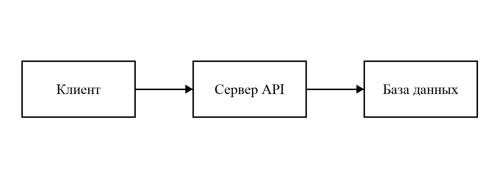

# Проектирование сервиса {#sec:design}

## Архитектура

Сервис состоит из трех частей (рисунок [@fig:arch]). Клиент обращается только к серверу API, а сервер сам решает, какие запросы отправить в базу.

{#fig:arch width=15}

## Схема данных

Основные таблицы базы перечислены в таблице [@tbl:entities]. Поля `created_at` проставляются на стороне базы, чтобы не зависеть от часов на сервере приложений.

Таблица: Основные таблицы базы данных {#tbl:entities}

| Таблица | Назначение | Число полей |
|---|---|---|
| customers | Покупатели | 6 |
| orders | Заказы | 8 |
| order_items | Позиции заказа | 5 |

Итоговая стоимость заказа считается по формуле [@eq:total]:

$$ *S* = Σ *p*ᵢ · *q*ᵢ $$ {#eq:total}

где *p*ᵢ – цена позиции, руб.; *q*ᵢ – количество, шт.
